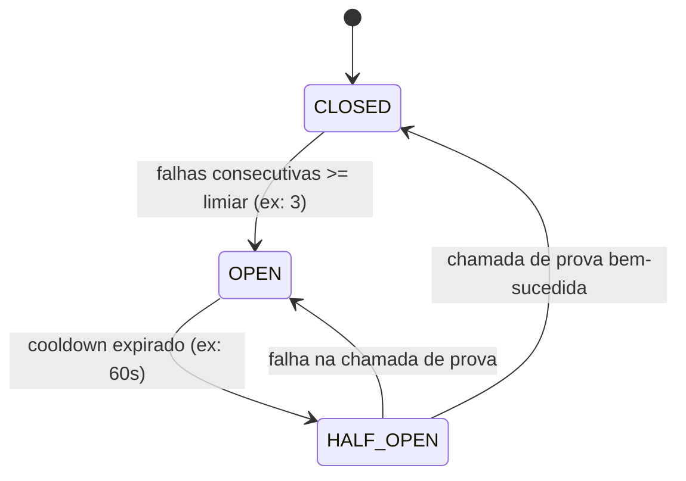

# Multi-Provider LLM Failover & Provider Cascade

Este documento descreve a arquitetura, política de resiliência, Circuit Breaker e governança de dados da camada de failover multi-provedor (*Provider Cascade*) do projeto **KITCHEN INTEL**.

---

## 1. Princípio Arquitetural: Benchmark vs. Produção

O projeto distingue formalmente dois modos de operação mutuamente exclusivos:

| Dimensão | `BENCHMARK_MODE` | `PRODUCTION_MODE` |
|---|---|---|
| **Objetivo Primário** | Comparabilidade científica e reprodutibilidade. | Disponibilidade contínua de serviço (uptime). |
| **Política de Fallback** | **Estritamente proibido** (`allow_fallback: false`). | **Permitido e auditável** (`allow_fallback: true`). |
| **Comportamento na Falha** | A chamada é interrompida e registrada como erro. | Executa a cascata ordenada de provedores até o determinístico. |
| **Isolamento de Amostra** | 100% dos registros sob exatamente o mesmo modelo e prompt. | Pode combinar diferentes provedores/modelos por registro. |
| **Validade para Gate** | Obrigatório para aprovação de gates científicos (ex.: Gate 5). | Destinado a operações em tempo real e pipelines contínuos. |

### Por que o Benchmark não permite Fallback?
Em testes de hipóteses científicas e benchmarks formais de LLMs (como o Gate 5 com 76 registros), a pergunta formulada é:
> *"Qual o desempenho estatístico (F1, Precision, Recall, Acurácia) do modelo X com o prompt Y sobre o domínio Z?"*

Se um registro for avaliado pelo modelo A e outro pelo modelo B para contornar um rate limit, a amostra perde homogeneidade estatística. A métrica resultante não representaria nem o modelo A nem o modelo B, invalidando conclusões científicas.

### Por que a Produção permite Fallback?
Em ambiente operacional (produção comercial), a prioridade se inverte:
> *"O analista comercial ou pipeline de prospecção precisa da classificação do edital sem interrupção de serviço decorrente de cotas, instabilidade ou indisponibilidade temporária de um único provedor."*

Portanto, em produção, o sistema prioriza disponibilidade (*high availability*), mantendo rastreabilidade total do provedor utilizado.

---

## 2. Qualidade vs. Disponibilidade & Riscos de Heterogeneidade

A utilização de múltiplos modelos em cascata introduz um compromisso (*trade-off*) crítico de engenharia:

1. **Variação Semântica e Decisória:** Diferentes arquiteturas (ex.: Nemotron 120B vs. Gemini 2.5 Flash vs. GPT-OSS 120B vs. GPT-5.6 Luna) possuem calibrações de confiança e pesos semânticos distintos. Um modelo menor ou mais permissivo pode classificar como `MEDIA` o que outro classificaria como `BAIXA`.
2. **Divergência de Confiança:** Escores de probabilidade reportados por LLMs não são calibrados na mesma escala.
3. **Degradação Graciosa (*Graceful Degradation*):** Quando todos os provedores neurais de LLM estão inacessíveis ou esgotados, o sistema recorre ao **Baseline Determinístico (`rules_v0.1.1`)**.
   - O baseline determinístico possui 100% de disponibilidade e latência sub-milissegundo, mas opera apenas por casamento explícito de vocabulário e regras sintáticas.
   - O sistema registra explicitamente `provider_used="deterministic"` e `model_used="rules_v0.1.1"`, impedindo que a predição seja falsamente atribuída a uma inteligência generativa.

---

## 3. Configuração Declarativa do Roteamento

A cascata é governada declarativamente por `config/provider_routing.json`:

```json
{
  "version": "1.0.0",
  "default_mode": "benchmark",
  "benchmark": {
    "allow_fallback": false,
    "provider": "openrouter",
    "model": "nvidia/nemotron-3-super-120b-a12b:free"
  },
  "production": {
    "allow_fallback": true,
    "providers": [
      { "provider": "openrouter", "model": "nvidia/nemotron-3-super-120b-a12b:free" },
      { "provider": "gemini", "model": "gemini-2.5-flash" },
      { "provider": "groq", "model": "openai/gpt-oss-120b" },
      { "provider": "openai", "model": "gpt-5.6-luna" },
      { "provider": "deterministic", "model": "rules_v0.1.1" }
    ],
    "circuit_breaker": {
      "failure_threshold": 3,
      "cooldown_seconds": 60.0
    }
  }
}
```

Nenhum segredo ou chave de API reside no arquivo de configuração. Todas as credenciais continuam lidas estritamente de variáveis de ambiente locais (`.env`).

---

## 4. Política de Failover (*Failover Policy*)

O roteador inspeciona a natureza do erro retornado pelo provedor antes de decidir pelo avanço na cascata:

### Erros Elegíveis para Fallback (`FAILOVER_ELIGIBLE_ERRORS`):
- `RATE_LIMITED` (HTTP 429, esgotamento de quota diária ou por minuto)
- `TIMEOUT` (latência excedida na conexão ou resposta)
- `NETWORK_ERROR` (erros de rede transientes, resolução de DNS, conexão recusada)
- `MODEL_UNAVAILABLE` (HTTP 404, modelo em manutenção ou removido do catálogo)
- `PROVIDER_5XX` (HTTP 500, 502, 503, 504 no gateway do provedor)
- `AUTH_FAILED` (HTTP 401/403, chave expirada ou revogada — marca o provedor como indisponível e segue)
- `NO_CREDITS` (saldo financeiro ou créditos pré-pagos zerados na conta)
- `CIRCUIT_OPEN` (circuito aberto por falhas recentes)

### Erros Não-Elegíveis para Fallback Automático (`NON_FAILOVER_ERRORS`):
- `SCHEMA_ERROR` (resposta JSON do modelo com schema estruturalmente inválido após retry)
- `INVALID_REQUEST` (formatação de payload incorreta enviada pelo cliente)
- `DATA_VALIDATION_ERROR` (violação semântica das regras de domínio)

*Racional:* Erros de payload ou schema indicam problemas na especificação ou no parser, e não uma indisponibilidade transitória de infraestrutura. Trocar de modelo em caso de erro de schema de prompt arrisca propagar respostas corrompidas.

---

## 5. Arquitetura do Circuit Breaker

Cada provedor possui uma instância isolada de `CircuitBreaker` determinístico local:



1. **`CLOSED` (Normal):** Todas as chamadas para o provedor são liberadas normalmente. Falhas consecutivas incrementam o contador.
2. **`OPEN` (Aberto):** Se `consecutive_failures >= failure_threshold`, o circuito abre. Qualquer requisição subsequente para esse provedor é imediatamente ignorada (`status="SKIPPED"`, `error_type="CIRCUIT_OPEN"`), sem incorrer em custos de rede ou latência.
3. **`HALF_OPEN` (Semi-Aberto):** Transcorrido o período de `cooldown_seconds`, o circuito permite uma única chamada controlada de prova (*canary probe*). Se for bem-sucedida, o circuito fecha (`CLOSED`) e o contador zera; se falhar, o circuito retorna a `OPEN` por mais um ciclo de cooldown.

---

## 6. Rastreabilidade e Esquema Canônico de Auditoria

Toda inferência executada via `ProviderRouter` gera um `OperationalClassificationResult` imutável, contendo a trilha completa de tentativas em `attempt_traces`:

```json
{
  "request_id": "req_8f12a9c3d4e5",
  "provider_requested": "openrouter",
  "model_requested": "nvidia/nemotron-3-super-120b-a12b:free",
  "provider_used": "gemini",
  "model_used": "gemini-2.5-flash",
  "fallback_used": true,
  "fallback_level": 1,
  "fallback_reason": "openrouter quota exhausted (429)",
  "providers_attempted": ["openrouter", "gemini"],
  "prompt_version": "0.1.0",
  "input_hash": "a1b2c3d4e5...",
  "relevant": true,
  "relevance": "ALTA",
  "categories": ["COZINHA", "COCCAO"],
  "confidence": 95,
  "reason": "Edital para fornecimento de fogão industrial para cozinha hospitalar.",
  "input_tokens": 820,
  "output_tokens": 110,
  "total_tokens": 930,
  "latency_ms": 1420.5,
  "estimated_cost": 0.0000945,
  "started_at": "2026-09-13T12:30:00.000000+00:00",
  "finished_at": "2026-09-13T12:30:01.420500+00:00",
  "attempt_traces": [
    {
      "provider": "openrouter",
      "model": "nvidia/nemotron-3-super-120b-a12b:free",
      "attempt_number": 1,
      "started_at": "2026-09-13T12:30:00.000000+00:00",
      "finished_at": "2026-09-13T12:30:00.410000+00:00",
      "http_status": 429,
      "status": "FAILED",
      "error_type": "RATE_LIMITED",
      "latency_ms": 410.0,
      "retry_count": 0,
      "error_message_sanitized": "HTTP 429 Daily rate limit reached"
    },
    {
      "provider": "gemini",
      "model": "gemini-2.5-flash",
      "attempt_number": 2,
      "started_at": "2026-09-13T12:30:00.415000+00:00",
      "finished_at": "2026-09-13T12:30:01.420000+00:00",
      "http_status": 200,
      "status": "SUCCESS",
      "error_type": null,
      "latency_ms": 1005.0,
      "retry_count": 0,
      "error_message_sanitized": null
    }
  ],
  "status": "SUCCESS",
  "error": null
}
```

---

## 7. Segregação de Cache e Higienização de Segredos

1. **Segregação Criptográfica:** O cache determinístico (`LLMCache`) indexa predições através do hash SHA-256 de `input_hash + provider + model + prompt_version`. Predições de provedores distintos nunca colidem nem sobrepõem seus resultados.
2. **Higienização Mandatória:** A função `sanitize_error_message` aplica expressões regulares estritas sobre todas as strings de erro, substituindo padrões como `Authorization: Bearer <token>`, `api_key=<key>` e tokens identificados (`sk-...`, `gsk_...`, `aior-...`) pela tag auditável `[REDACTED]`.
